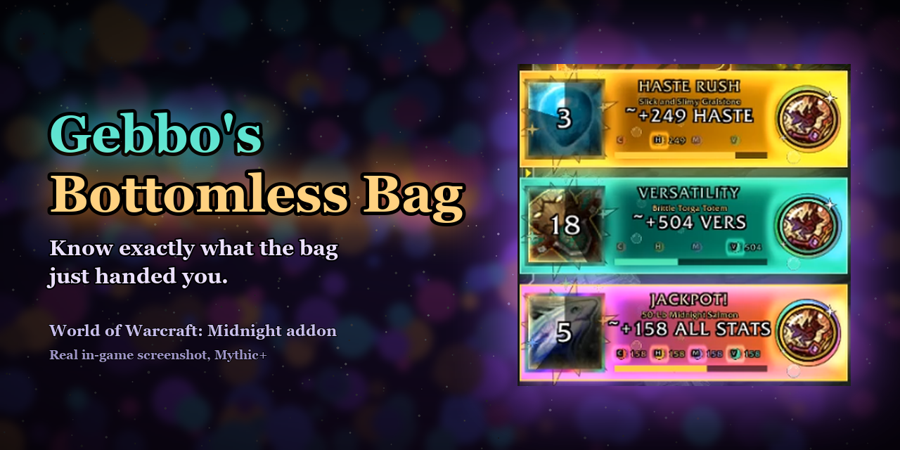
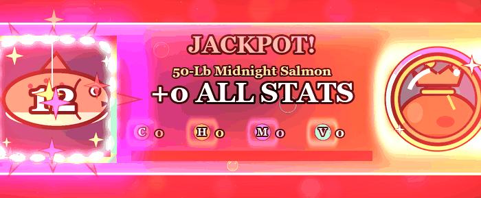
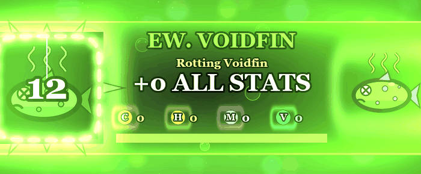
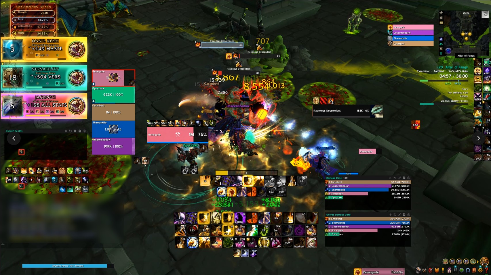
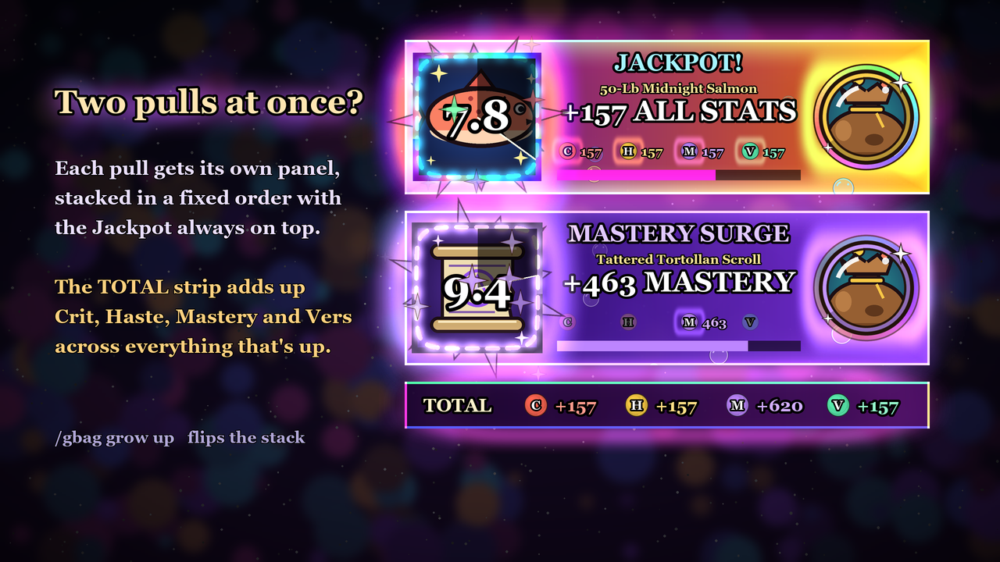
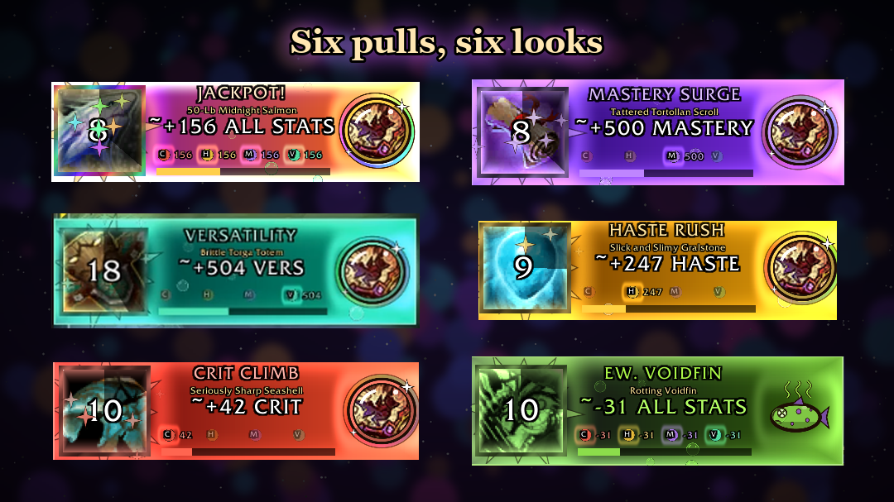
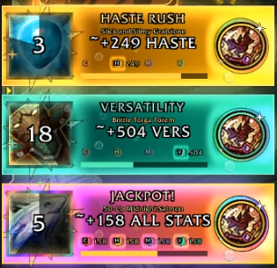

# Gebbo's Bottomless Bag

**Know exactly what the bag just handed you.**

**[Download the latest release](https://github.com/rlucas2100/rlucas2100-GebbosTrinket_World_of_Warcraft/releases/latest)** · **[Report a bug or suggest an idea](https://github.com/rlucas2100/rlucas2100-GebbosTrinket_World_of_Warcraft/issues)**

A World of Warcraft (Midnight) addon for the **Gebbo's Bottomless Bag** trinket. Every time the bag pulls something out, a big, glowing alert pops up and tells you which pull it is, **how much Critical Strike, Haste, Mastery or Versatility it's giving you (or taking away)**, and how long it lasts. Each pull plays its own retro reward chime.

  
  

## See it in game

Mythic+ (Altar of Fangs): three pulls up at once, top left. Inside keys the game draws the alert and the amounts are item-level estimates, marked with `~`.

---

## Why you want it

The bag has six possible pulls. Some are great, some fade over time, one climbs, one crumbles as you cast, and one is just bad. Without help you're reading buff tooltips mid-fight. With this addon you know at a glance:

- **Which pull you got**, with its own colours, title and look
- **The exact stat change**, in big numbers: `+157 ALL STATS`, `+463 MASTERY`, `-31 ALL STATS`
- **What it's doing right now**: the Scroll's Mastery counts down as it fades, the Totem counts down your casts, the Seashell's Crit climbs every second
- **How long it lasts**, with a big countdown on the icon and a draining bar
- **Your total**, when two pulls overlap: a panel each, plus a TOTAL strip adding up all four stats

## The six pulls

| Pull | What it does | How the alert shows it |
| --- | --- | --- |
| **50-Lb Midnight Salmon** | All secondary stats up | **JACKPOT!** Full rainbow panel, screen flash, jackpot fanfare |
| **Tattered Tortollan Scroll** | Big Mastery, fading every second | **MASTERY SURGE** in violet; the number counts down live |
| **Brittle Torga Totem** | Versatility that crumbles as you cast | **VERSATILITY** in jade; counts your remaining casts |
| **Slick and Slimy Gralstone** | Haste and movement speed | **HASTE RUSH** in gold |
| **Seriously Sharp Seashell** | Crit that climbs each second (but it cuts you) | **CRIT CLIMB** in red; the number climbs live |
| **Rotting Voidfin** | All secondary stats down | **EW. VOIDFIN**: sickly green panel, wobble, green flash, a sad "aww" |

## The look and the sound

- **Big, bright alerts**: a large icon in a rainbow-metal frame with sparkle ants, a countdown sweep and big timer numbers. Rotating light rays, sparks flying out, bubbles rising through the panel, and cycling glows.
- **A cartoon badge** on the right showing the trinket's own icon (and a rotten fish for the Voidfin).
- **Cel-shaded stat gems** (C / H / M / V) that light up for the stats each pull affects.
- **Entrance pop, screen flash and wobble** for the big moments (Jackpot and Voidfin).
- **Original retro reward sounds**: a glittering staircase fanfare for the Jackpot, a short sparkle for the other pulls, and a bubbly sad "aww" for the Voidfin.
- **Pops up only when a pull is active**, then gets out of your way. Or keep the bag on screen between pulls with `/gbag idle`.

The banner, the Mythic+ shot and the six-pulls grid are real in-game screenshots. The two animations and the TOTAL-strip picture are previews rendered from the addon's own textures, colours and animation timings (`tools/render_previews.py`), with stand-in art where the game shows the pull's spell icon and the trinket's icon.

## Install

1. Download `GebboBagTracker.zip` from the [latest release](https://github.com/rlucas2100/rlucas2100-GebbosTrinket_World_of_Warcraft/releases/latest) (or from CurseForge).
2. Copy the `GebboBagTracker` folder into `World of Warcraft/_retail_/Interface/AddOns/`.
3. Fully restart the game. New sounds and textures don't load on `/reload`.
4. Type `/gbag test salmon` to see the jackpot alert.

## Moving and sizing

1. Type `/gbag unlock`. The alert appears so you can place it.
2. **Drag** it with the left mouse button.
3. **Resize** it by holding **Ctrl and scrolling the mouse wheel** over it, or drag the **grip in the bottom-right corner**.
4. Type `/gbag lock` when done.

You can also set the size directly with `/gbag scale 1.3` (anything from 0.3 to 3), or use the Size slider in the settings window. If it ever goes off-screen, `/gbag reset` puts it back in the middle.

## Commands

Everything works with `/gbag` (or `/gebbo`).

| Command | What it does |
| --- | --- |
| `/gbag test` | Preview a random pull |
| `/gbag test salmon` | Preview a specific pull: `salmon`, `scroll`, `totem`, `gralstone`, `seashell` or `voidfin` |
| `/gbag unlock` / `/gbag lock` | Move and resize the alert, then lock it in place |
| `/gbag scale 1.3` | Set the size (0.3 to 3) |
| `/gbag grow up` / `/gbag grow down` | Which way extra panels stack when two pulls overlap |
| `/gbag idle` | Keep the bag on screen between pulls (on/off) |
| `/gbag sound` | Sounds on/off |
| `/gbag flash` | Screen flash on Jackpot and Voidfin (on/off) |
| `/gbag engine auto\|on\|off` | How the raid & Mythic+ display is used (see below) |
| `/gbag config` | Open the settings window |
| `/gbag stats` | This session's pulls and buff uptime |
| `/gbag status` | What the addon is detecting right now |
| `/gbag reset` | Put the alert back in the middle at normal size |
| `/gbag ids` / `/gbag setid <pull> <spellID>` | Show or add the spell IDs it watches (rarely needed) |
| `/gbag errors` | Show any errors the addon caught and handled |

The settings window (`/gbag config`, the addon button by the minimap, or **Options → AddOns → Gebbo's Bag Tracker**) has the same options, plus the sound channel and preview buttons.

## Raids and Mythic+

In Midnight, the game hides buff details from addons inside raids, boss fights and Mythic+. In those places Gebbo's Bottomless Bag switches to a **game-drawn alert**: the game itself finds the pull and draws the panel, timer and bar, so they're always exact. The stat amount there is an **estimate for your item level**, marked with `~`. The pull sounds still play, because they're handed to the game's own aura-sound system.

Everywhere else, the numbers are read straight from your buff and are exact. Estimates (`~`) calibrate themselves the first time a Salmon, Gralstone or Voidfin lands in the open world.

 

## FAQ

**Nothing shows up.** Make sure the trinket is equipped, and try `/gbag test`. If you hear a pull but see nothing, you may be in a raid or key with `/gbag engine off`; use `/gbag engine auto`.

**I hear a pull twice.** Untick *Let the game play them (raids & M+)* in `/gbag config`.

**A pull isn't recognised.** `/gbag ids` shows the spell IDs being watched. The Salmon's ID is built in and the other five are found by name. On non-English clients you may need `/gbag setid <pull> <spellID>`.

## Feedback

Found a bug, or a pull that isn't showing? [Open an issue](https://github.com/rlucas2100/rlucas2100-GebbosTrinket_World_of_Warcraft/issues) and include what `/gbag status` says. Ideas are welcome too.

## Credits

Made by **Ryan** ([rlucas2100](https://github.com/rlucas2100)). Sounds and cartoon art are original, made for this addon. Built with love for the bag, the fish, and especially the Voidfin.
